  

  

  
  
  
  

---

## ⚡ Core Engineering Focus

<table>
  <tr>
    <td width="50%" valign="top">
      <h3>🤖 AI Tooling &amp; Self-Hosted Infra</h3>
      
Designing secure Model Context Protocol servers, OAuth 2.1 + PKCE authorization flows, and bilingual OpenAI-compatible gateways.

      
<strong>Work:</strong> <a href="https://github.com/lowji194/serverops-mcp">serverops-mcp</a> · <a href="https://github.com/lowji194/ChatGPT2Api-english">ChatGPT2Api-english</a>

    </td>
    <td width="50%" valign="top">
      <h3>🧩 Chromium MV3 Extensions</h3>
      
Building privacy-first browser extensions with PAC routing, AES-256-GCM local vaults, and regional ad-blocking filters.

      
<strong>Work:</strong> <a href="https://github.com/lowji194/Extension-ProxyFlow">Extension-ProxyFlow</a> · <a href="https://github.com/lowji194/Extension-Cookie-Manager">Extension-Cookie-Manager</a> · <a href="https://github.com/lowji194/AdsBlock-Filter">AdsBlock-Filter</a>

    </td>
  </tr>
  <tr>
    <td width="50%" valign="top">
      <h3>🖥️ Windows Desktop &amp; Mobile Automation</h3>
      
Shipping portable Edge WebView2 apps with DPAPI credential vaults, Rainmeter integrations, and Android UI test drivers.

      
<strong>Work:</strong> <a href="https://github.com/lowji194/codex-session-manager">codex-session-manager</a> · <a href="https://github.com/lowji194/AtxSharp">AtxSharp</a> · <a href="https://github.com/lowji194/Module-Magisk">Module-Magisk</a>

    </td>
    <td width="50%" valign="top">
      <h3>⚙️ Web Services, Bots &amp; Workspace Apps</h3>
      
Practical tools connecting Google Drive, Gmail, Google Sheets, and Telegram bots for everyday operational workflows.

      
<strong>Work:</strong> <a href="https://github.com/lowji194/mini-google-drive">mini-google-drive</a> · <a href="https://github.com/lowji194/Bot-telegram-Tracuuphatnguoi">Bot-telegram-Tracuuphatnguoi</a> · <a href="https://github.com/lowji194/GmailWebClient">GmailWebClient</a>

    </td>
  </tr>
</table>

---

## 🚀 Flagship Projects

| Project | Highlights &amp; Capabilities | Stack |
| :--- | :--- | :--- |
| [**`serverops-mcp`**](https://github.com/lowji194/serverops-mcp) | Root-capable MCP server for Linux host administration with OAuth 2.1 + PKCE, out-of-band owner approval, and staged rollback | `Node.js` `MCP` `OAuth 2.1` `SQLite` |
| [**`codex-session-manager`**](https://github.com/lowji194/codex-session-manager) | Windows multi-session &amp; quota manager with macOS Pastel UI, DPAPI-encrypted backups, and Rainmeter skin integration | `Python` `PyWebView` `WebView2` `PowerShell` |
| [**`Extension-ProxyFlow`**](https://github.com/lowji194/Extension-ProxyFlow) | MV3 proxy switcher featuring Auto Switch rules, PAC routing, AES-256-GCM encrypted vault, and live network monitor | `JavaScript` `Manifest V3` `WebCrypto` |
| [**`ChatGPT2Api-english`**](https://github.com/lowji194/ChatGPT2Api-english) | Bilingual OpenAI-compatible gateway and Next.js operations console with automatic country-based locale detection | `TypeScript` `Python` `Next.js` `Docker` |
| [**`mini-google-drive`**](https://github.com/lowji194/mini-google-drive) | Lightweight Express web portal for folder-preserving uploads, overwrites, and shareable links via Google Drive API v3 | `Node.js` `Express` `Google Drive API` |
| [**`Bot-telegram-Tracuuphatnguoi`**](https://github.com/lowji194/Bot-telegram-Tracuuphatnguoi) | Telegram bot for tracking Vietnamese traffic violations, managing license plates, and sending automated weekly alerts | `Python` `Telegram Bot API` `Flask` |

---

## 📊 Live GitHub Dashboard

  

  

  

  Live data from <a href="https://theloi.io.vn/">theloi.io.vn</a> · <a href="https://github.com/lowji194?tab=repositories">Browse all public repositories →</a>

---

## 🛠 Tech Stack

| Layer | Technologies |
| :--- | :--- |
| **Languages** |         |
| **Web &amp; Backend** |      |
| **Clients &amp; Automation** |      |
| **Infrastructure** |     |

---

  <strong>Từ Sơn, Bắc Ninh, Vietnam</strong> · Open to technical collaboration, automation consulting, and open-source feedback. 
  <a href="mailto:theloi194@gmail.com">theloi194@gmail.com</a> · <a href="https://theloi.io.vn/">theloi.io.vn</a> · <a href="https://t.me/theloi194">@theloi194</a>

