  

  

  
  
  
  

---

## ⚡ Trọng tâm kỹ thuật

<table>
  <tr>
    <td width="50%" valign="top">
      <h3>🤖 AI Tooling &amp; Hạ tầng tự vận hành</h3>
      
Thiết kế máy chủ Model Context Protocol bảo mật với luồng xác thực OAuth 2.1 + PKCE và các API gateway tương thích OpenAI.

      
<strong>Dự án:</strong> <a href="https://github.com/lowji194/serverops-mcp">serverops-mcp</a> · <a href="https://github.com/lowji194/ChatGPT2Api-english">ChatGPT2Api-english</a>

    </td>
    <td width="50%" valign="top">
      <h3>🧩 Tiện ích trình duyệt Chromium MV3</h3>
      
Xây dựng extension ưu tiên quyền riêng tư với định tuyến PAC, kho lưu trữ mã hóa AES-256-GCM cục bộ và bộ lọc chặn quảng cáo Việt Nam.

      
<strong>Dự án:</strong> <a href="https://github.com/lowji194/Extension-ProxyFlow">Extension-ProxyFlow</a> · <a href="https://github.com/lowji194/Extension-Cookie-Manager">Extension-Cookie-Manager</a> · <a href="https://github.com/lowji194/AdsBlock-Filter">AdsBlock-Filter</a>

    </td>
  </tr>
  <tr>
    <td width="50%" valign="top">
      <h3>🖥️ Ứng dụng Windows &amp; Tự động hóa</h3>
      
Phát triển ứng dụng Edge WebView2 đóng gói portable, sao lưu mã hóa DPAPI, skin Rainmeter và thư viện điều khiển UI Android.

      
<strong>Dự án:</strong> <a href="https://github.com/lowji194/codex-session-manager">codex-session-manager</a> · <a href="https://github.com/lowji194/AtxSharp">AtxSharp</a> · <a href="https://github.com/lowji194/Module-Magisk">Module-Magisk</a>

    </td>
    <td width="50%" valign="top">
      <h3>⚙️ Dịch vụ Web, Bot &amp; Workspace</h3>
      
Công cụ thực dụng kết nối Google Drive, Gmail, Google Sheets và Telegram Bot phục vụ quy trình công việc hằng ngày.

      
<strong>Dự án:</strong> <a href="https://github.com/lowji194/mini-google-drive">mini-google-drive</a> · <a href="https://github.com/lowji194/Bot-telegram-Tracuuphatnguoi">Bot-telegram-Tracuuphatnguoi</a> · <a href="https://github.com/lowji194/GmailWebClient">GmailWebClient</a>

    </td>
  </tr>
</table>

---

## 🚀 Dự án tiêu biểu

| Dự án | Điểm nổi bật &amp; Chức năng | Công nghệ |
| :--- | :--- | :--- |
| [**`serverops-mcp`**](https://github.com/lowji194/serverops-mcp) | Máy chủ MCP quản trị Linux hỗ trợ OAuth 2.1 + PKCE, phê duyệt ngoài luồng (out-of-band) và triển khai kèm rollback | `Node.js` `MCP` `OAuth 2.1` `SQLite` |
| [**`codex-session-manager`**](https://github.com/lowji194/codex-session-manager) | Trình quản lý đa phiên &amp; quota trên Windows với giao diện macOS Pastel, mã hóa DPAPI và tích hợp Rainmeter | `Python` `PyWebView` `WebView2` `PowerShell` |
| [**`Extension-ProxyFlow`**](https://github.com/lowji194/Extension-ProxyFlow) | Tiện ích chuyển proxy MV3 hỗ trợ quy tắc Auto Switch, PAC, két mã hóa AES-256-GCM và giám sát mạng | `JavaScript` `Manifest V3` `WebCrypto` |
| [**`ChatGPT2Api-english`**](https://github.com/lowji194/ChatGPT2Api-english) | API gateway tương thích OpenAI song ngữ Anh–Việt kèm bảng điều khiển Next.js tự nhận diện vùng ngôn ngữ | `TypeScript` `Python` `Next.js` `Docker` |
| [**`mini-google-drive`**](https://github.com/lowji194/mini-google-drive) | Cổng web Express nhẹ giúp tải lên giữ nguyên cây thư mục, ghi đè tệp và chia sẻ liên kết qua Google Drive API v3 | `Node.js` `Express` `Google Drive API` |
| [**`Bot-telegram-Tracuuphatnguoi`**](https://github.com/lowji194/Bot-telegram-Tracuuphatnguoi) | Bot Telegram theo dõi biển số xe, tra cứu vi phạm giao thông và tự động cảnh báo định kỳ hằng tuần | `Python` `Telegram Bot API` `Flask` |

---

## 📊 Thống kê GitHub trực tiếp

  

  

  

  Dữ liệu trực tiếp từ <a href="https://theloi.io.vn/">theloi.io.vn</a> · <a href="https://github.com/lowji194?tab=repositories">Xem toàn bộ repository công khai →</a>

---

## 🛠 Công nghệ sử dụng

| Nhóm | Công nghệ |
| :--- | :--- |
| **Ngôn ngữ** |         |
| **Web &amp; Backend** |      |
| **Client &amp; Tự động hóa** |      |
| **Hạ tầng** |     |

---

  <strong>Từ Sơn, Bắc Ninh, Việt Nam</strong> · Sẵn sàng trao đổi kỹ thuật, tư vấn tự động hóa và tiếp nhận góp ý mã nguồn mở. 
  <a href="mailto:theloi194@gmail.com">theloi194@gmail.com</a> · <a href="https://theloi.io.vn/">theloi.io.vn</a> · <a href="https://t.me/theloi194">@theloi194</a>

